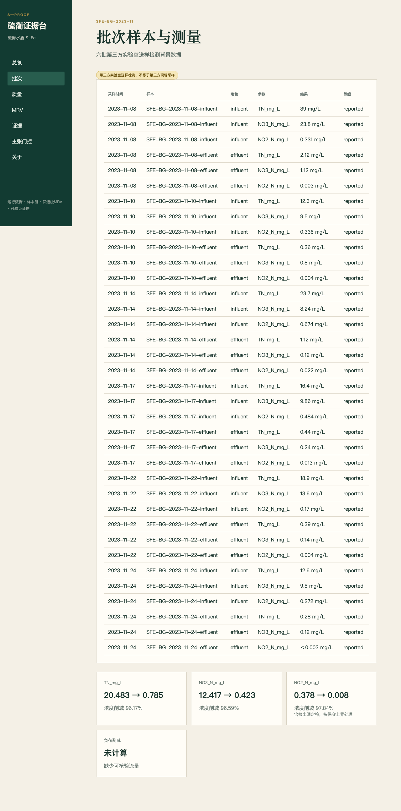

# 硫衡证据台 S-Proof

SFe Proof 是“硫衡水盾 S-Fe”的运行与证据模块：把水处理批次、样本链、质量检查、筛选级 MRV、主张边界和哈希证书连成可追溯闭环。

## 当前真实状态

`main` 已完成真实端到端闭环；[`v0.2.1-competition`](https://github.com/exergyleizhou-ux/sfe-proof/releases/tag/v0.2.1-competition) 是当前比赛发布版本，包含量纲修正与发布链加固。启动时从 `seed/` 幂等导入 PostgreSQL，Dashboard、批次、详情、质量、MRV、证据、Claim Gate 与证书页面均读取或调用真实 API。前端不保存决定业务结论的样本、MRV 或质量常量；API 不可用时明确失败，不会显示模拟 `pass` 或 `valid`。SQLite 只用于隔离单元测试。



## 5 分钟运行

前置：Docker、Node 24、uv（仅宿主机测试需要）。

```bash
make bootstrap
make test
make lint
make audit
make build
make up
make smoke
make e2e
```

浏览器访问 `http://localhost:5173`，API 文档位于 `http://localhost:8000/docs`。`make down` 停止服务。

## 演示路径

首页 API 计数 → PostgreSQL 背景样本与测量 → 指定批次质量扫描 → 注册因子 MRV → Claim Gate 全部命中规则 → 从数据库批次生成 manifest → 提交 manifest 验证。另有后端验证接口被拦截的负向浏览器测试，页面必须显示“无法验证”。

## 架构

```text
React 18 / Vite 构建 / 非特权 Nginx / 中文评委界面
             │ /api/v1
FastAPI / Pydantic / 领域服务 / OpenAPI
             │ SQLAlchemy + Alembic
         PostgreSQL 16
```

这是模块化单体，不含微服务、消息队列、大模型或付费 API。Docker Compose 一条命令启动三个主要服务；前端运行镜像不包含 Node 开发依赖，前后端应用容器均不以 root 身份运行。

## 证据等级与贡献边界

- 背景证据：第三方送样检测、技术报告、查新、评价、专利和组件验证的结构化摘要。
- 学生 P0：必须由团队另行采集并完整登记；系统不会把背景数据冒充学生实测。
- `measured/reported/estimated/placeholder` 保留活动和测量等级；关键数字旁显示来源/状态。

六批检测属于“第三方实验室送样检测”，报告没有记录现场采样人和现场采样地点，不能表述为第三方现场监测。

## 计算与碳边界

只有配对浓度时报告“浓度削减”；有可核验流量和时间对应后才计算负荷。`<检出限` 按检出限作保守上界，不替换为零。质量平衡缺项返回 `incomplete`，5% 演示容差需按装置历史噪声校准。

MRV 活动明确区分 `baseline/project`，活动量与注册因子均使用 low/base/high 三组值分别重算。因子按版本从 `EmissionFactor` 注册表读取，不接受客户端内联因子。活动单位必须与因子分母匹配；`g/kg/t CO2e` 因子统一归一为 `kgCO2e` 后才允许求和，异常因子值与未知因子版本返回 422。N₂O 未处理、同等出水目标未确认、关键活动缺失或存在占位项时返回 `indeterminate`。输出单位为 `kgCO2e/m3` 或 `kgCO2e/kg TN`，与实际数值量纲一致。

## 证书保证与不保证

证书可下载 `certificate-manifest.json`，包含 canonical input/result、双哈希、算法版本、服务端 Git SHA 与因子版本。验证必须由调用者上传 manifest 或提交完整输入和结果；空 payload 返回 `needs_payload`。修改输入或结果均失败，重复签发相同输入会得到不同证书 ID。它不证明采样真实性、科学结论正确，也不等于第三方核证或碳信用。

## 当前限制与赛前待补

团队仍需补充学生 P0 实测、完整采样链、流量/水力信息、材料与能源活动、N₂O 测量方法及非占位因子授权来源。公开仓库不含受限技术报告或检测 PDF 原件。系统不是 SCADA 或自动控制器。

## 测试、来源与许可

2026-07-13 v0.2.1 主线验收：后端 97 个隔离测试通过，另有 2 个 PostgreSQL API 集成测试；前端 10 个测试；Playwright 2 条真实栈测试，其中一条专门拦截证书后端并确认页面不显示成功。Ruff、TypeScript/Vite、Python 与 npm 漏洞审计、双镜像构建、Alembic `0005`、Compose smoke 均纳入门禁。`0005` 会修正既有 MRV 记录的错误 `gCO2e` 标签但不改变数值。清库启动后的数据库计数为 1 个项目、1 个批次、12 个样本、36 条测量与 3 个排放因子。CI 仅在 `main` 与面向 `main` 的 PR 运行，使用 Node 24 运行时并取消同一分支的过期任务。

复用审计见 `docs/REUSE_ASSESSMENT.md`，代码声明见 `CODE_ORIGIN.md`，贡献与团队责任表见 `CONTRIBUTIONS.md`。本仓库代码采用 MIT License；背景材料既有权利不受影响。`v0.2.1-competition`、`v0.2.0-competition` 与 `v0.1.0-competition` 均为不可移动标签；后续修复必须使用新版本。

本软件服务于全国大学生零碳科技创新大赛第二支队伍的“面向低 C/N 尾水的硫铁复合自养深度脱氮除磷与低碳运行系统”，不构成独立创业方向或碳交易产品。
