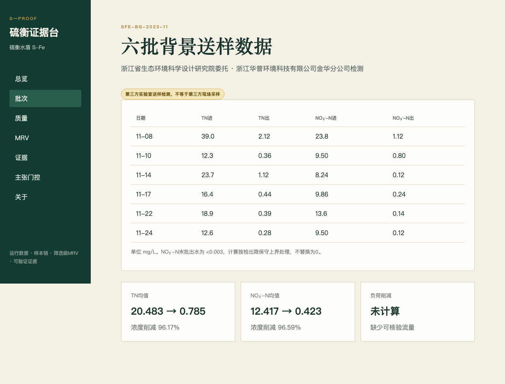

# 硫衡证据台 S-Proof

SFe Proof 是“硫衡水盾 S-Fe”的运行与证据模块：把水处理批次、样本链、质量检查、筛选级 MRV、主张边界和哈希证书连成可追溯闭环。

## 当前真实状态

v0.1.0 competition freeze 实现了固定最小 API、六批背景数据、浓度/负荷/质量平衡、12 类质量约束覆盖、筛选级 MRV 门控、九类 Claim Gate、证书生成/验证、中文九页面、后端/前端测试与 Playwright 浏览器闭环。正式运行使用 PostgreSQL 16；SQLite 仅用于单元与 API 测试。



## 5 分钟运行

前置：Docker、Node 20、uv（仅宿主机测试需要）。

```bash
make bootstrap
make test
make lint
make build
make up
make smoke
make e2e
```

浏览器访问 `http://localhost:5173`，API 文档位于 `http://localhost:8000/docs`。`make down` 停止服务。

## 演示路径

首页 → 六批背景数据 → 来源边界 → 质量检查 → MRV 待定状态 → Claim Gate 拦截“世界首创的零碳系统” → 生成证书 → 验证成功。逐秒脚本见 `docs/DEMO_SCRIPT.md`。

## 架构

```text
React 18 / Vite / 中文评委界面
             │ /api/v1
FastAPI / Pydantic / 领域服务 / OpenAPI
             │ SQLAlchemy + Alembic
         PostgreSQL 16
```

这是模块化单体，不含微服务、消息队列、大模型或付费 API。Docker Compose 一条命令启动三个主要服务。

## 证据等级与贡献边界

- 背景证据：第三方送样检测、技术报告、查新、评价、专利和组件验证的结构化摘要。
- 学生 P0：必须由团队另行采集并完整登记；系统不会把背景数据冒充学生实测。
- `measured/reported/estimated/placeholder` 保留活动和测量等级；关键数字旁显示来源/状态。

六批检测属于“第三方实验室送样检测”，报告没有记录现场采样人和现场采样地点，不能表述为第三方现场监测。

## 计算与碳边界

只有配对浓度时报告“浓度削减”；有可核验流量和时间对应后才计算负荷。`<检出限` 按检出限作保守上界，不替换为零。质量平衡缺项返回 `incomplete`，5% 演示容差需按装置历史噪声校准。

MRV 是筛选级核算。N₂O 未处理、关键活动缺失或存在占位因子时只能返回 `indeterminate`，不显示确认减排。

## 证书保证与不保证

证书以键排序规范 JSON 绑定输入、结果、算法版本、Git SHA 与因子版本。任一输入或结果改变都会验证失败。它证明计算来源和文件完整性；不证明采样真实性，不证明算法科学结论正确，也不等于第三方核证或碳信用。

## 当前限制与赛前待补

团队仍需补充学生 P0 实测、完整采样链、流量/水力信息、材料与能源活动、N₂O 测量方法及非占位因子授权来源。公开仓库不含受限技术报告或检测 PDF 原件。系统不是 SCADA 或自动控制器。

## 测试、来源与许可

2026-07-13 冻结验收：后端 67 个测试通过，前端 6 个测试通过，Playwright 1 条真实浏览器闭环通过；`make lint`、生产构建、Docker Compose PostgreSQL 迁移 `0002`、`make smoke` 均已实际通过。复用审计见 `docs/REUSE_ASSESSMENT.md`，代码声明见 `CODE_ORIGIN.md`，贡献边界见 `CONTRIBUTIONS.md`。本仓库代码采用 MIT License；背景材料的既有权利不受影响。

本软件服务于全国大学生零碳科技创新大赛第二支队伍的“面向低 C/N 尾水的硫铁复合自养深度脱氮除磷与低碳运行系统”，不构成独立创业方向或碳交易产品。
